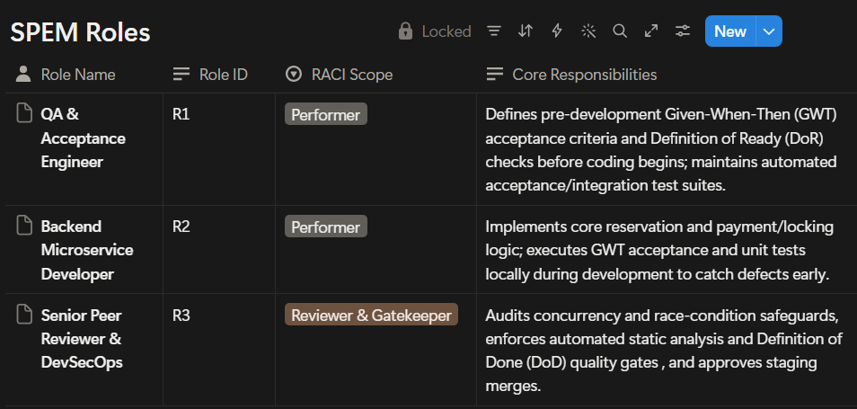
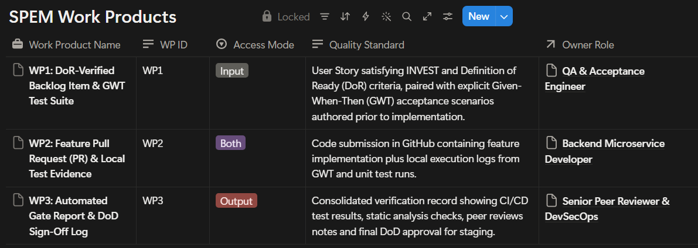
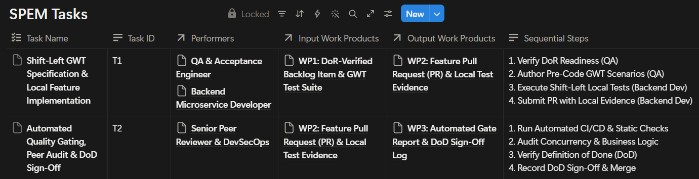
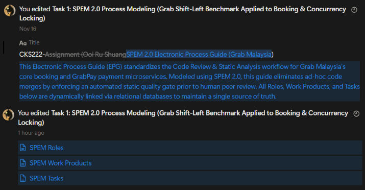
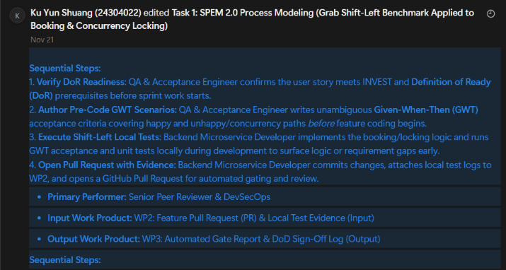
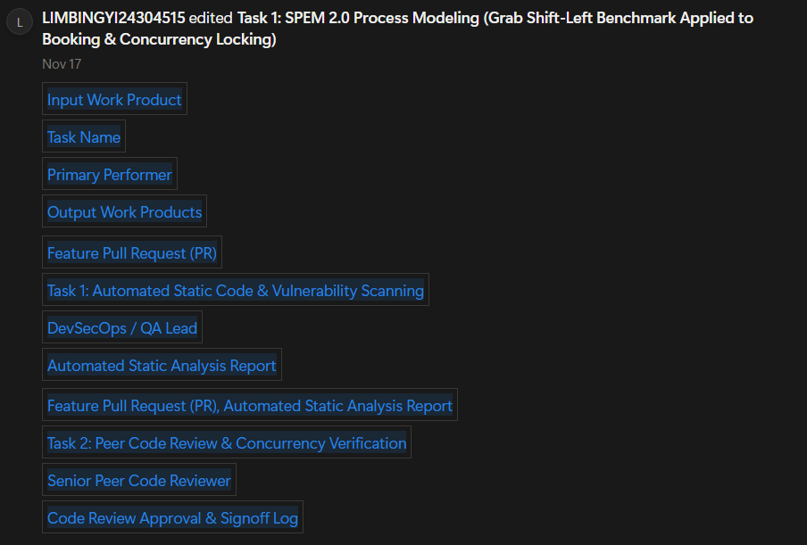
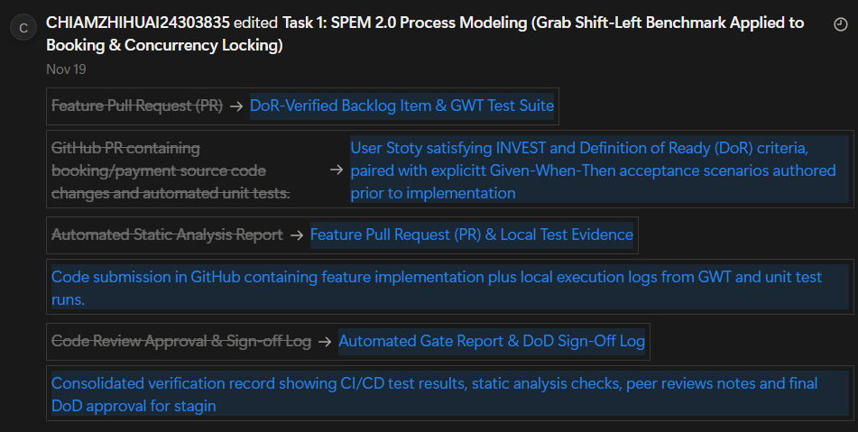
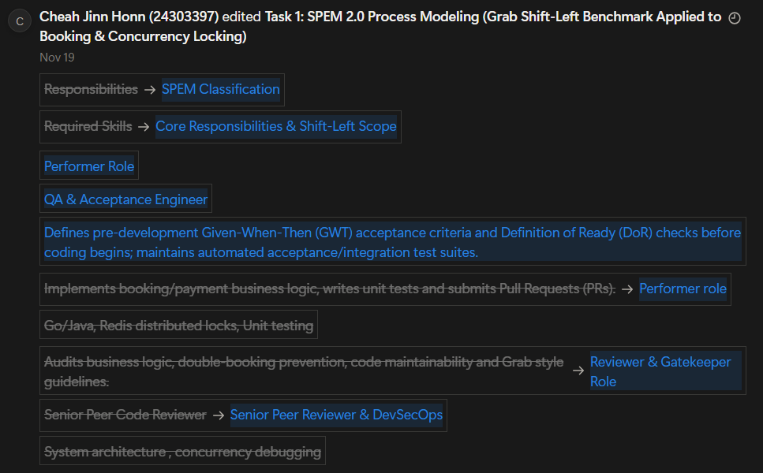

# Task 1: Process Definition & Modeling (Shift-Left Quality Engineering Applied to Facility Booking & Concurrency Locking)

Drawing on **Grab Malaysia’s Shift-Left quality engineering principles**  to prevent ad-hoc merging, late-stage defect leakage, and race conditions, the standardized **Code Review & Static Analysis** workflow below is modeled in **OMG SPEM 2.0** and applied to our **USM Campus Facility Booking & Concurrency Locking** lifecycle:

---

## 1.1 SPEM 2.0 Process Model: Code Review & Static Analysis
To resolve ad-hoc merging and inconsistent code quality across Grab Malaysia's booking and payment microservices, the following standardized **Code Review & Static Analysis** workflow is modeled using SPEM 2.0 and implemented in Notion:

### A. Roles
| Role ID | Role Name | SPEM Classification | Core Responsibilities|
| :--- | :--- | :--- | :--- |
| R1 | **`QA & Acceptance Engineer`** | Performer Role | Defines Definition of Ready (DoR) checks and Given-When-Then (GWT) acceptance criteria *before* implementation begins; maintains automated acceptance and integration test suites.|
| R2 | **`Backend Microservice Developer`** | Performer Role | Implements reservation, concurrency locking, and payment workflows; executes GWT acceptance and unit tests locally during development to catch defects early.|
| R3 | **`Senior Peer Reviewer & DevSecOps`** | Reviewer & Gatekeeper Role | Audits concurrency and race-condition logic, enforces automated static analysis and Definition of Done (DoD) quality gates, and signs off staging merges.|

### B. Work Products 
| WP ID | Work Product Name | Access Mode | Owner Role | Purpose & Quality Standard |
| :--- | :--- | :--- | :--- | :--- |
| **WP1** | **DoR-Verified Backlog Item & GWT Test Suite** | `Input` | **`QA & Acceptance Engineer`** | INVEST-compliant user story meeting DoR criteria, paired with pre-authored GWT acceptance scenarios covering happy and concurrency/edge paths. |
| **WP2** | **Feature Pull Request (PR) & Local Test Evidence** | `Output`  `Input` | **`Backend Microservice Developer`** | GitHub PR containing feature and concurrency lock code plus local execution logs from GWT and unit test runs. |
| **WP3** | **Automated Gate Report & DoD Sign-Off Log** | `Output` | **`Senior Peer Reviewer & DevSecOps`** | Verification record capturing CI/CD test execution, static analysis thresholds (test coverage and critical issue checks), peer reviews notes, and DoD staging approval. |

### C. Tasks & Sequential Steps
| Task ID | Task Name | Performers | Input Work Product | Output Work Product |
| :--- | :--- | :--- | :--- | :--- |
| **T1** | **Shift-Left GWT Specification & Local Feature Implementation** | `QA & Acceptance Engineer & Backend Microservice Developer` | `WP1: DoR-Verified Backlog Item & GWT Test Suite` | `WP2: Feature Pull Request (PR) & Local Test Evidence`|
| **T2** | **Automated Quality Gating, Peer Audit & DoD Sign-Off** | `Senior Peer Reviewer & DevSecOps`| `WP2: Feature Pull Request (PR) & Local Test Evidence` | `WP3: Automated Gate Report & DoD Sign-Off Log`|

#### Task 1: Shift-Left GWT Specification & Local Feature Implementation
* **Sequential Steps:**
  1. **Verify DoR Readiness:** `QA & Acceptance Engineer` confirms the backlog item satisfies INVEST and **Definition of Ready (DoR)** criteria before coding starts.
  2. **Author Pre-Code GWT Scenarios:** `QA & Acceptance Engineer` writes explicit **Given-When-Then (GWT)** acceptance criteria for happy and unhappy/concurrency paths prior to development.
  3. **Execute Shift-Left Local Tests:** `Backend Microservice Developer` implements the booking/locking logic and runs GWT and unit tests locally during development to detect defects and requirement gaps early.
  4. **Submit PR with Local Evidence:** `Backend Microservice Developer` commits the code, attaches local test logs to `WP2: Feature Pull Request (PR) & Local Test Evidence`, and opens a Pull Request for automated gating and review.

#### Task 2: Automated Quality Gating, Peer Audit & DoD Sign-Off
* **Sequential Steps:**
  1. **Run Automated CI/CD & Static Checks:** `Senior Peer Reviewer & DevSecOps` oversees automated test suites and static analysis checks; any failure blocks merge progression.
  2. **Audit Concurrency & Business Logic:** `Senior Peer Reviewer & DevSecOps` inspects the PR for race conditions (like double-booking or lock expiry edge cases) and code maintainability, requesting revisions if issues are found.
  3. **Verify Definition of Done (DoD):** `Senior Peer Reviewer & DevSecOps` verifies that all **DoD** criteria (automated test thresholds, zero critical issues, passing pipeline, resolved feedback) are met.
  4. **Record DoD Sign-Off & Merge:** `Senior Peer Reviewer & DevSecOps` records formal approval in `WP3: Automated Gate Report & DoD Sign-Off Log` and merges the PR into the staging branch.
---

## 1.2 RACI Governance Matrix (Grab Booking & Payment Lifecycle)
To enforce unambiguous accountability across 5-member reorganized team structure, the table below maps **six key deliverables** derived directly from 3 work products and 2 tasks across **five specialized roles**:  
* **`QA & Acceptance Engineer`** writes pre-code GWT acceptance criteria and checks DoR readiness, 
* **`Backend Microservice Developer`** builds booking/locking logic and runs local tests before opening PRs, 
* **`Senior Peer Reviewer & DevSecOps`** reviews concurrency logic, enforces automated quality gates, and approves staging merges, 
* **`Product Owner / Tech Lead`** owns backlog scope, DoR approval, and release alignment,
* **`UI / Frontend Developer`** handles client-side booking UI and frontend test alignment.

*Legend: **R** = Responsible, **A** = Accountable, **C** = Consulted, **I** = Informed*

| # | Lifecycle Deliverable | QA & Acceptance Engineer | Backend Microservice Developer | Senior Peer Reviewer & DevSecOps | Product Owner / Tech Lead | UI / Frontend Developer |
| :- | :--- | :---: | :---: | :---: | :---: | :---: |
| **D1** | **WP1: DoR-Verified Backlog Item & GWT Test Suite**| **R** | **C** | **I** | **A** | **C** |
| **D2** | **Concurrency Booking Core & Shift-Left Local Test Run**| **C** | **R / A** | **I** | **I** | **C** |
| **D3** | **WP2: Feature Pull Request (PR) & Local Test Evidence**| **I** | **R / A** | **I** | **I** | **I** |
| **D4** | **Automated CI/CD & Static Analysis Gate**| **C** | **C** | **R / A** | **I** | **C** |
| **D5** | **Concurrency Logic Audit & DoD Verification**| **I** | **C** | **R / A** | **I** | **I** |
| **D6** | **WP3: Automated Gate Report & DoD Sign-Off Log**| **I** | **I** | **R / A** | **C** | **I** |

---

## 1.3 Notion Electronic Process Guide (EPG) Relational Architecture & Audit Evidence

To satisfy SPEM 2.0 metamodel traceability rather than relying on static documentation, the Electronic Process Guide (EPG) is implemented in Notion using **three interconnected relational databases**:

1. **`Roles` Database (`R1`–`R3`):** Stores role definitions and links bi-directionally via Notion `Relation` properties to both `SPEM Work Products` (ownership) and `SPEM Tasks` (task execution).
2. **`Work Products` Database (`WP1`–`WP3`):** Tracks artifact access modes (`Input`, `Output / Input`, `Output`), quality standards, owning roles, and upstream/downstream task links.
3. **`Tasks` Database (`T1`–`T2`):** Connects each task and its sequential steps directly to its assigned `Performers`, `Input Work Product`, and `Output Work Product` via live Notion relation chips.

*Figure 1.3.1: SPEM Roles relational database (`R1`–`R3`).*

*Figure 1.3.2: SPEM Work Products relational database (`WP1`–`WP3`).*

*Figure 1.3.3: SPEM Tasks relational database (`T1`–`T2`).*

---

### Collaborative Audit & Version History Evidence

To verify authentic, multi-member participation across the SPEM 2.0 Electronic Process Guide (EPG) lifecycle, the Notion **Updates** log below captures timestamped edits from all five team members between **16 November and 25 November 2026**. Each member contributed directly to defining, refining, and linking the relational SPEM Roles, Work Products, and Tasks databases:

* **Ooi Ru Shuang (`24304522` [`rushuangooi@student.usm.my`] — Group Leader):** Initialized the Notion EPG workspace, configured public collaboration permissions, authored the Shift-Left Mandate and Zero-Bypass governance policies, and finalized the relational database links across **SPEM Roles**, **SPEM Work Products**, and **SPEM Tasks**.

*Figure 1.3.4: Notion collaborative update history for Ooi Ru Shuang (`24304522`).*

* **Ku Yun Shuang (`24304022` [`yunshuang@student.usm.my`]):** Authored and structured the sequential execution steps for **T1 (Shift-Left GWT Specification & Local Feature Implementation)** and **T2 (Automated Quality Gating, Peer Audit & DoD Sign-Off)**, mapping each task to its assigned performers and input/output work products. 

*Figure 1.3.5: Notion collaborative update history for Ku Yun Shuang (`24304022`).*

* **Lim Bing Yi (`24304515` [`bingyi06iz@student.usm.my`]):** Established the initial relational table schema for SPEM tasks and mapped primary performers (`DevSecOps / QA Lead` and `Senior Peer Code Reviewer`) to their corresponding input and output artifacts. 

*Figure 1.3.6: Notion collaborative update history for Lim Bing Yi (`24304515`).*

* **Chiam Zhi Huai (`24303835` [`zhuai@student.usm.my`]):** Refined the **SPEM Work Products (`WP1`–`WP3`)** database entries, standardizing artifact titles, access modes (`Input`, `Both`, `Output`), and quality standard descriptions for DoR-verified backlog items, Feature PRs, and DoD sign-off logs. 

*Figure 1.3.7: Notion collaborative update history for Chiam Zhi Huai (`24303835`).*

* **Cheah Jinn Honn (`24303397` [`jinnhonn@student.usm.my`]):** Defined and updated the **SPEM Roles (`R1`–`R3`)** database, specifying SPEM classifications (`Performer Role` vs. `Reviewer & Gatekeeper Role`), required technical skills, and core responsibilities for concurrency auditing and pre-development GWT checks. 

*Figure 1.3.8: Notion collaborative update history for Cheah Jinn Honn (`24303397`).*

Access the live Notion Electronic Process Guide (EPG) containing our interconnected SPEM 2.0 Roles, Work Products, and Tasks relational databases here: [SPEM 2.0 Electronic Process Guide (EPG)](https://app.notion.com/p/Task-1-SPEM-2-0-Process-Modeling-Grab-Shift-Left-Benchmark-Applied-to-Booking-Concurrency-Lockin-41a3730380e28052a264f1a9014ac87a?source=copy_link)

